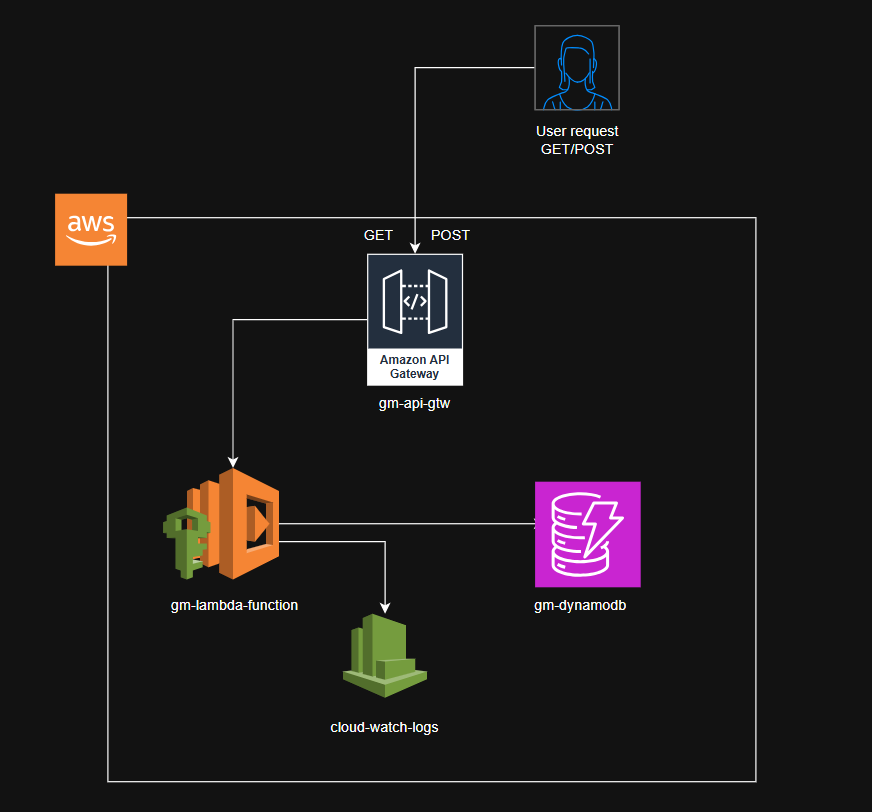
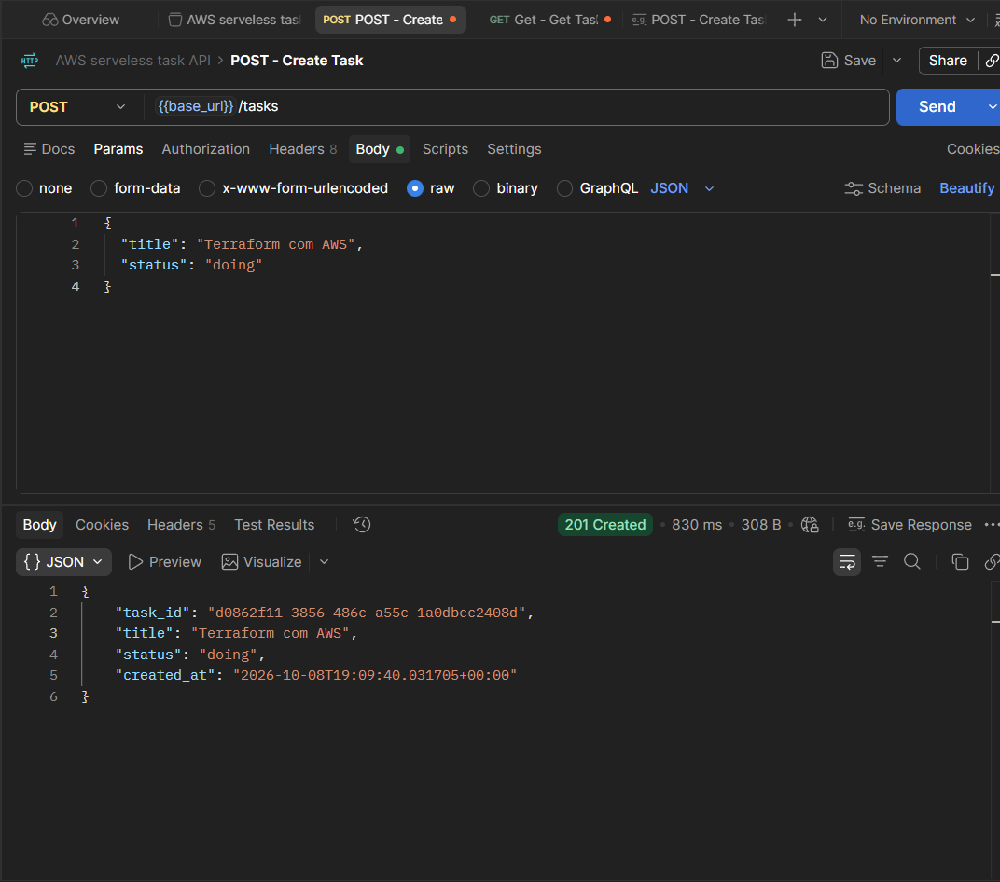
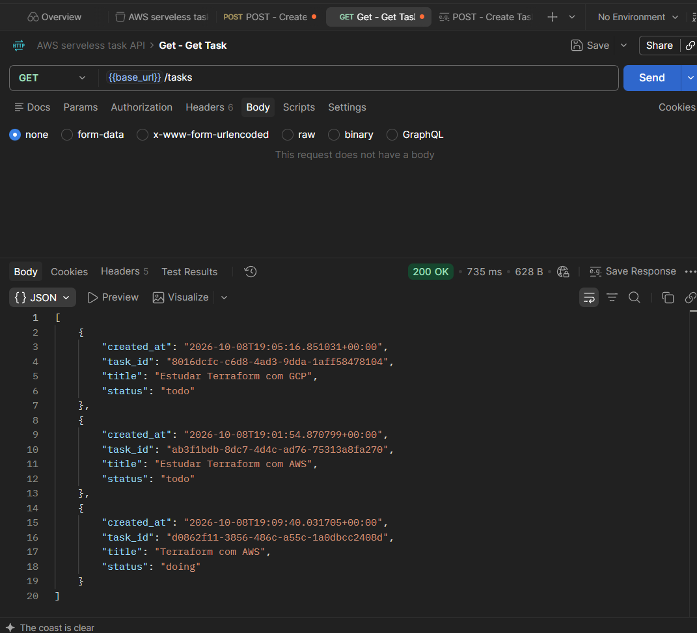
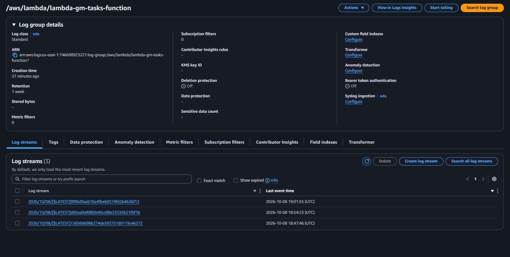

# Serverless Tasks API with AWS Lambda and DynamoDB

This project provisions a small serverless REST API on AWS using Terraform. The API accepts `GET` and `POST` requests for tasks, runs the request handling code in AWS Lambda, and stores task records in Amazon DynamoDB.

## Project level

**Beginner to intermediate.** The application is intentionally small, but the infrastructure combines several AWS services and requires understanding Terraform resource dependencies, Lambda execution permissions, API Gateway integrations, and DynamoDB access.

## Architecture


```text
Client / Postman
       |
       | HTTP GET /tasks or POST /tasks
       v
API Gateway HTTP API
       |
       | AWS_PROXY integration (payload format 2.0)
       v
AWS Lambda (Python 3.12)
       |                  \
       | read/write        \ application logs
       v                    v
Amazon DynamoDB         Amazon CloudWatch Logs
```

Terraform creates the resources in `us-east-1` (N. Virginia). The API Gateway `$default` stage deploys automatically. API Gateway is allowed to invoke the Lambda function, and the Lambda execution role grants the function access to the task table and its CloudWatch log group.

### Request behavior

- `GET /tasks` scans the DynamoDB table and returns its items.
- `POST /tasks` reads a JSON request body and creates an item containing `task_id`, `title`, `status`, and `created_at`. If omitted, `title` defaults to `"Sem título"` and `status` defaults to `"todo"`.
- Other methods return HTTP `405`.
- Responses are JSON. The Lambda response and API Gateway both configure permissive CORS (`*`).

Example request body:

```json
{
  "title": "Write project documentation",
  "status": "todo"
}
```

The API endpoint is exposed as the Terraform output `api_endpoint`. Append `/tasks` to it to call the routes.

## Infrastructure and implementation methodology

The infrastructure is defined declaratively: Terraform describes the desired AWS resources, calculates dependencies between them, and applies the changes through the AWS and Archive providers. The Lambda source file is packaged as a ZIP archive by Terraform before it is uploaded.

The design uses a serverless, managed-service approach:

1. API Gateway provides the HTTP entry point and routes requests to Lambda.
2. Lambda runs the application code on demand; its table name is supplied through an environment variable.
3. DynamoDB stores tasks using `task_id` as the string partition key and on-demand (`PAY_PER_REQUEST`) billing.
4. IAM grants the Lambda role DynamoDB table access and permission to write logs.
5. CloudWatch Logs retains the Lambda log group for seven days.

The Python handler supports both API Gateway HTTP API v2 and the legacy `httpMethod` event shape when determining the request method. The configured integration sends payload format version 2.0.

## Repository files

| File or folder | Purpose |
|---|---|
| `apigateway.tf` | Defines the HTTP API, CORS settings, Lambda proxy integration, `GET /tasks` and `POST /tasks` routes, the auto-deploying `$default` stage, and permission for API Gateway to invoke Lambda. |
| `cloudwatch.tf` | Creates the Lambda log group with a seven-day retention period. |
| `dynamodb.tf` | Defines the `tasks` DynamoDB table, its configurable name, string `task_id` partition key, and on-demand billing mode. |
| `iam.tf` | Defines the Lambda execution role and inline policy for DynamoDB operations and CloudWatch Logs. |
| `lambda.tf` | Packages `lambda/tasks.py` into a ZIP file and configures the Lambda function, runtime, handler, role, timeout, memory, and table-name environment variable. |
| `locals.tf` | Defines common project tags. These locals are currently not referenced by the resources. |
| `output.tf` | Exposes the API endpoint, DynamoDB table name, and Lambda function name after deployment. |
| `provider.tf` | Configures the AWS provider region (`us-east-1`). |
| `variables.tf` | Declares the table, Lambda, and API names, with defaults. |
| `versions.tf` | Sets the Terraform minimum version and AWS/Archive provider version constraints. |
| `.terraform.lock.hcl` | Locks provider selections and checksums for more repeatable Terraform initialization. |
| `lambda/tasks.py` | Implements the Lambda handler for listing and creating tasks and formatting HTTP responses. |
| `lambda/tasks.zip` | Lambda deployment archive generated from `lambda/tasks.py` by the Archive provider. |
| `project3-lambda-serveless-with-dynamoDB.drawio` | Editable Draw.io architecture diagram. |
| `.$project3-lambda-serveless-with-dynamoDB.drawio.bkp` | Draw.io backup file. |
| `images/` | Screenshots documenting the infrastructure and Postman/API and CloudWatch test evidence. |
| `terraform.tfstate`, `terraform.tfstate.backup` | Local Terraform state and its backup. These are generated state artifacts, not source configuration; state can contain sensitive infrastructure data and should not be published. |
| `.terraform/` | Terraform's downloaded provider/cache directory. It is generated locally and should not be committed. |

## Test evidence

The API was tested with Postman. The screenshots below are the evidence files present in `images/`:

| Evidence | Screenshot |
|---|---|
| POST request to API Gateway |  |
| GET request to API Gateway |  |
| CloudWatch Lambda logs |  |

These images document manual testing; this repository does not currently include automated application or infrastructure tests.

## Prerequisites

- Terraform `>= 1.6.0`
- AWS credentials configured for an account with permission to create the listed resources
- Network access to download the Terraform providers

## Deploy

Run these commands from the project directory:

```shell
terraform init
terraform validate
terraform plan
terraform apply
```

Terraform prints the API endpoint and resource names after a successful apply. Send requests to `<api_endpoint>/tasks`.

## Improvement opportunities

- Restrict API CORS origins to the actual client instead of `*`; consider authentication and authorization for a public endpoint.
- Replace `Scan` with a paginated and appropriately keyed `Query` or `GetItem` design as data grows; DynamoDB scans read the table and do not scale efficiently.
- Validate request JSON and task fields, and return clear `400` responses for malformed or invalid input. Consider handling DynamoDB and unexpected exceptions explicitly.
- Review log retention, monitoring, alarms, and cost controls for the intended environment; seven-day log retention is currently fixed in configuration.
- Add pagination, input size limits, and safer defaults if the API is intended for production use.
- Extend the project with additional AWS services to improve security, resilience, and event-driven capabilities:
  - **Amazon Cognito:** add a user pool for sign-up and sign-in, then configure an API Gateway JWT authorizer on the task routes. The client sends its access token with each request, and the API rejects unauthenticated or unauthorized calls before invoking Lambda. The current API has no authentication.
  - **Amazon SNS:** publish an event to an SNS topic after a task is created or updated. Subscribers such as email endpoints, SQS queues, or other Lambda functions can then receive notifications without coupling those consumers to the API handler. Grant the Lambda role only the required `sns:Publish` permission.
  - **Amazon SQS:** use a queue to buffer asynchronous work, such as task notifications or heavier task processing, and have a separate Lambda consumer process messages and persist or update data in DynamoDB. Configure retries and a dead-letter queue (DLQ) for messages that repeatedly fail. If task creation itself becomes asynchronous, return `202 Accepted` rather than implying the task has already been saved.
  - **AWS WAF:** add web request filtering and rate-based rules to protect the public API from common web exploits and excessive request rates. API Gateway HTTP APIs do not support direct AWS WAF association; to keep this API type, put a CloudFront distribution with AWS WAF in front of it. Alternatively, migrate to an API Gateway REST API stage and associate a web ACL there.
