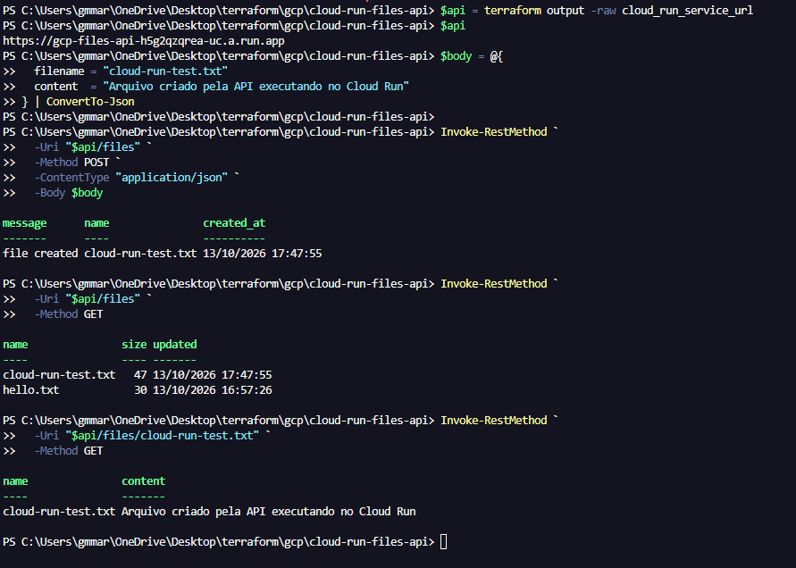
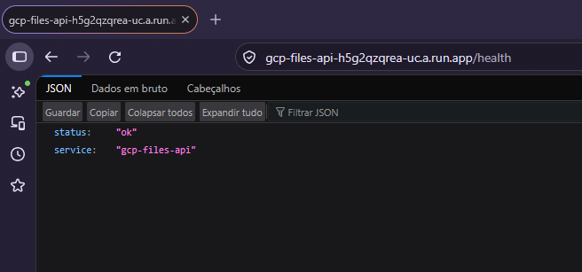
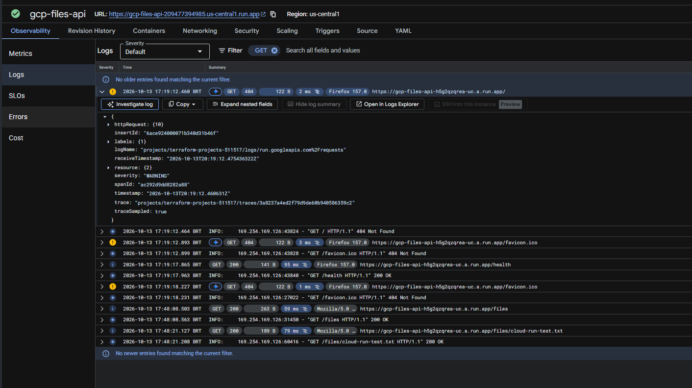
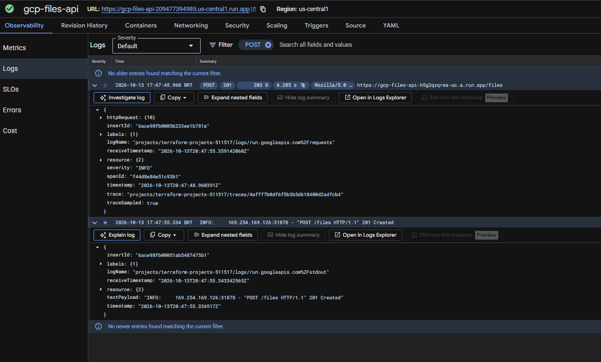
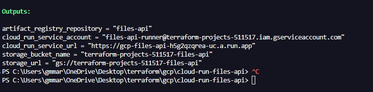

# GCP Cloud Run Files API

A hands-on infrastructure lab that provisions a FastAPI service on Google Cloud Run and a private Cloud Storage bucket using Terraform. The container image is built locally with Docker and manually published to Artifact Registry before deploying Cloud Run.

> Lab only: the API is intentionally public and unauthenticated. Although the bucket blocks direct public access, anyone who can reach the API can use its file endpoints. Do not store sensitive data or use this configuration for production.

## Architecture

```text
Local workstation                          Google Cloud project

Docker build --> Docker push ------------> Artifact Registry
                                                |
                                                | container image
                                                v
Internet / Postman -------- HTTPS --------> Cloud Run (FastAPI)
                                                |
                                                | dedicated service account
                                                v
                                           Cloud Storage
                                           private bucket

Cloud Run --------------------------------> Cloud Logging / Monitoring
                                            automatic platform integration

Terraform provisions APIs, repository, bucket, service account,
bucket IAM bindings, and Cloud Run. Docker builds and publishes the image.
```

The runtime service account has bucket-level `roles/storage.objectViewer` and `roles/storage.objectCreator`. It can list/read objects and create new ones, but it cannot delete or overwrite existing objects.

Cloud Run receives `GOOGLE_CLOUD_PROJECT` and `BUCKET_NAME` as environment variables. In Google Cloud, it authenticates using its attached service account, without a downloaded service account key. Local Docker testing uses the developer's Application Default Credentials (ADC) mounted read-only into the container. These are different identities and must be tested separately.

## Configuration choices

- The bucket uses uniform bucket-level access and enforced public access prevention. IAM controls access; object ACLs are not used.
- Cloud Run uses a dedicated service account instead of a broad default identity.
- The service is public through `invoker_iam_disabled = true`; this is a disposable lab choice, not application authorization.
- Cloud Run is configured with a minimum of zero and maximum of one instance, 1 vCPU, and 512 MiB of memory. These settings reduce lab scope but do not guarantee zero cost or impose a spending cap.
- The bucket allows deletion of its contents during Terraform destruction through `force_destroy = true`.
- Object lifecycle deletion is configured for seven days in `storage.tf`. Lifecycle deletion is asynchronous, not an exact expiration timer.
- Artifact Registry and Cloud Run use `us-central1`. The bucket is regional `US-CENTRAL1`, not multi-region `US`.
- The current Cloud Run image path contains `us-central1` directly. Changing `var.region` alone does not update that path or the hard-coded bucket location: review both configurations together.
- Cloud Build API is enabled in `apis.tf`, but Cloud Build is not used by the workflow documented here. The image is built and pushed manually using local Docker.

## Repository contents

| File or directory | Purpose |
| --- | --- |
| `versions.tf` | Requires Terraform 1.6+ and allows Google provider versions in the 7.x major release series. |
| `.terraform.lock.hcl` | Records provider selections/checksums; commit this file. |
| `providers.tf` | Configures project, region, and default labels. |
| `variables.tf` | Declares `project_id` and `region`. |
| `terraform.tfvars` | Local project and region values created for deployment; do not commit this file. |
| `apis.tf` | Enables the required APIs with `disable_on_destroy = false`. |
| `artifact-registry.tf` | Creates the Docker repository `files-api`. |
| `storage.tf` | Creates the private bucket and cleanup settings. |
| `iam.tf` | Creates the runtime service account and bucket IAM memberships. |
| `cloud-run.tf` | Defines Cloud Run, image, identity, environment variables, and scaling. |
| `outputs.tf` | Exposes the service URL and infrastructure identifiers defined in the code. |
| `app/main.py` | FastAPI health, list, create, and read endpoints. |
| `app/requirements.txt` | Application dependencies. |
| `app/Dockerfile` | Python container running Uvicorn on `0.0.0.0` and `$PORT` (default 8080). |
| `app/.dockerignore` | Excludes local files from the Docker build context. |
| `images/` | Screenshots of tests, outputs, and logs. |


## API endpoints

| Method | Path | Expected result |
| --- | --- | --- |
| `GET` | `/health` | `200`, basic application health response; does not test bucket access. |
| `GET` | `/files` | `200`, JSON array of names, sizes, and update times. |
| `POST` | `/files` | `201`, creates a text object from `filename` and `content`. |
| `GET` | `/files/{filename}` | `200`, JSON containing the name and text content. |

Example request body:

```json
{
  "filename": "example.txt",
  "content": "Hello from Cloud Run"
}
```

The last endpoint returns text inside a JSON response; it is not a generic binary download endpoint. 

Use a new filename for each Cloud Run upload test. With `Storage Object Creator`, overwriting an existing object is not allowed. The current application does not translate every SDK exception into a friendly HTTP response, so a failed overwrite or upstream permission error can appear as HTTP 500.

## Prerequisites

- An existing Google Cloud project with an active billing account linked to it.
- Terraform CLI 1.6 or newer.
- Google Cloud CLI (`gcloud`).
- Docker Desktop running Linux containers.
- PowerShell; commands below use PowerShell syntax and backticks for line continuation.
- An account with permission to enable APIs, provision the resources, push images, and attach the runtime service account to Cloud Run.
- Bucket object access for the developer account used for local testing. The runtime account's bucket permissions do not grant permissions to the developer's ADC identity.
- Optional: Postman.

This Terraform configuration uses an existing project; it does not create the project or billing account.

Check the tools:

```powershell
terraform version
gcloud --version
docker version
```

## Deployment order

A fresh checkout cannot deploy Cloud Run successfully before its referenced image exists. Follow this order:

```text
1. Configure project and local authentication.
2. Provision base infrastructure (without Cloud Run).
3. Build the Docker image.
4. Run and test the application locally against the real bucket.
5. Authenticate Docker and push the image to Artifact Registry.
6. Apply the complete Terraform configuration to deploy Cloud Run.
7. Test the deployed service and inspect logs.
```

Terraform manages infrastructure. Docker image builds, publishing, and HTTP tests are manual steps in this version of the lab.

## 1. Configure project and authentication

Run the following from the Terraform project directory (the directory containing `versions.tf`; `gcp/cloud-run-files-api/` in this repository). Replace the placeholder with your own Project ID, not the project display name or numeric project number.

```powershell
$ProjectId = "YOUR_GOOGLE_CLOUD_PROJECT_ID"
$Region = "us-central1"
$BucketName = "$ProjectId-files-api"
$ImageTag = "1.0.0"
$LocalImage = "gcp-files-api:$ImageTag"
$RemoteImage = "${Region}-docker.pkg.dev/${ProjectId}/files-api/gcp-files-api:${ImageTag}"

gcloud auth login
gcloud config set project $ProjectId
gcloud auth application-default login
gcloud auth application-default set-quota-project $ProjectId
```

`gcloud auth login` authenticates CLI commands. `gcloud auth application-default login` creates the local ADC used by Terraform and the Python SDK. They are separate credential configurations.

Create your local `terraform.tfvars`:

```hcl
project_id = "YOUR_GOOGLE_CLOUD_PROJECT_ID"
region     = "us-central1"
```

Verify the target project and billing:

```powershell
gcloud config get-value project
gcloud billing projects describe $ProjectId
```

The billing output should identify your project and show `billingEnabled: true`.

Check the ADC file without exposing its contents:

```powershell
$AdcPath = Join-Path $env:APPDATA "gcloud\application_default_credentials.json"
Test-Path $AdcPath
```

Expected: `True`. Do not print or commit this JSON file: it contains credentials.

Variables in these examples exist only in the current PowerShell session. Recreate them when opening another terminal.

## 2. Provision base infrastructure before Cloud Run

From the Terraform project directory (the directory containing `versions.tf`; `gcp/cloud-run-files-api/` in this repository):

```powershell
terraform init
terraform fmt
terraform validate
```

During the original incremental lab, Cloud Run was added only after the image was published. For replication from the complete repository, use the following one-time bootstrap to create the existing base resources without deploying Cloud Run:

```powershell
terraform plan `
  '-target=google_project_service.required' `
  '-target=google_artifact_registry_repository.files_api' `
  '-target=google_storage_bucket.files' `
  '-target=google_service_account.cloud_run' `
  '-target=google_storage_bucket_iam_member.files_object_viewer' `
  '-target=google_storage_bucket_iam_member.files_object_creator'

terraform apply `
  '-target=google_project_service.required' `
  '-target=google_artifact_registry_repository.files_api' `
  '-target=google_storage_bucket.files' `
  '-target=google_service_account.cloud_run' `
  '-target=google_storage_bucket_iam_member.files_object_viewer' `
  '-target=google_storage_bucket_iam_member.files_object_creator'
```

Review the plan before approving. Targeting produces warnings because the plan is partial. This is a one-time bootstrap workaround for the image dependency, not the normal deployment workflow. Always run a complete plan/apply after publishing the image. A future improvement is to split foundation and application deployment into separate Terraform root configurations.

Confirm the resources:

```powershell
gcloud services list --enabled --project $ProjectId
gcloud artifacts repositories list --location $Region --project $ProjectId
gcloud storage buckets describe "gs://$BucketName"
```

Console checks:

- APIs & Services -> Enabled APIs & services.
- Artifact Registry -> Repositories -> `files-api` (initially empty).
- Cloud Storage -> Buckets -> your bucket.
- IAM & Admin -> Service Accounts -> `files-api-runner`.
- Bucket -> Permissions -> runtime service account with Object Viewer and Object Creator.

If provisioning reports that Service Usage API is disabled, enable `serviceusage.googleapis.com` for the existing project using an authorized account before retrying. Also confirm that the operator can enable services.

## 3. Build the local Docker image

From the Terraform project directory (the directory containing `versions.tf`; `gcp/cloud-run-files-api/` in this repository):

```powershell
docker build -t $LocalImage ./app
docker images
```

The build context is `app/`, where `Dockerfile`, `requirements.txt`, and `main.py` exist. If you are already inside `app/`, use `.` instead of `./app`.

The application expects:

```text
GOOGLE_CLOUD_PROJECT
BUCKET_NAME
```

Its Cloud Storage client is configured as:

```python
project_id = os.environ["GOOGLE_CLOUD_PROJECT"]
bucket_name = os.environ["BUCKET_NAME"]
storage_client = storage.Client(project=project_id)
```

## 4. Run and test locally

Keep this terminal open while the container is running:

```powershell
docker run --rm `
  --name gcp-files-api-local `
  -p 8080:8080 `
  -e "GOOGLE_CLOUD_PROJECT=$ProjectId" `
  -e "BUCKET_NAME=$BucketName" `
  -e "GOOGLE_APPLICATION_CREDENTIALS=/root/.config/gcloud/application_default_credentials.json" `
  --mount "type=bind,source=$AdcPath,target=/root/.config/gcloud/application_default_credentials.json,readonly" `
  $LocalImage
```

The ADC is mounted at runtime, read-only; it is not copied into the image. `--mount` also fails explicitly if the source file is missing.

Expected startup: Uvicorn listening on `0.0.0.0:8080`.

Open another PowerShell window for tests:

```powershell
$LocalApi = "http://localhost:8080"
$LocalFilename = "local-test-$([guid]::NewGuid().ToString('N')).txt"

Invoke-RestMethod -Uri "$LocalApi/health" -Method GET

$Body = @{
  filename = $LocalFilename
  content  = "Hello from local Docker"
} | ConvertTo-Json

Invoke-RestMethod `
  -Uri "$LocalApi/files" `
  -Method POST `
  -ContentType "application/json; charset=utf-8" `
  -Body ([System.Text.Encoding]::UTF8.GetBytes($Body))

Invoke-RestMethod -Uri "$LocalApi/files" -Method GET
Invoke-RestMethod -Uri "$LocalApi/files/$LocalFilename" -Method GET
```

Expected results:

- Health response: `status = ok`.
- Create response: `message = file created`, filename, and timestamp.
- List response: includes the new object.
- Read response: returns the original text.

Confirm the object in Cloud Storage -> Buckets -> your bucket -> Objects.

These tests access the real bucket using your developer ADC, not the Cloud Run service account. Local success does not replace testing the deployed service.

Stop the local container with `Ctrl+C`. Because `--rm` is set, Docker removes the stopped container, not the image.

## 5. Publish the image to Artifact Registry

In the terminal where `$ProjectId`, `$Region`, `$LocalImage`, and `$RemoteImage` were defined:

```powershell
gcloud auth configure-docker "${Region}-docker.pkg.dev"
```

Approve the Docker configuration update when prompted. This sets up the gcloud credential helper for the registry hostname; it does not use the runtime service account or the mounted ADC file.

Tag and push:

```powershell
docker tag $LocalImage $RemoteImage
docker push $RemoteImage
```

The tag creates another reference to the same local image. A successful push ends with a digest such as `sha256:...`.

Verify:

```powershell
gcloud artifacts docker images list `
  "${Region}-docker.pkg.dev/${ProjectId}/files-api" `
  --include-tags `
  --project $ProjectId
```

Console: Artifact Registry -> Repositories -> `files-api` -> `gcp-files-api` -> tag `1.0.0`.

The publishing identity needs write permission on the repository. Do not grant Artifact Registry Writer to the runtime account just to fix a developer's push error.

## 6. Deploy Cloud Run with the complete Terraform configuration

From the Terraform project directory (the directory containing `versions.tf`; `gcp/cloud-run-files-api/` in this repository), confirm that `cloud-run.tf` points to the uploaded image:

```hcl
image = "us-central1-docker.pkg.dev/${var.project_id}/files-api/gcp-files-api:1.0.0"
```

Also confirm:

- `service_account = google_service_account.cloud_run.email`.
- `GOOGLE_CLOUD_PROJECT` and `BUCKET_NAME` are configured.
- Container port is 8080.
- `invoker_iam_disabled = true` is intentional for the lab.
- No `GOOGLE_APPLICATION_CREDENTIALS` variable or developer credential file is added to Cloud Run.

For a disposable lab, check whether `deletion_protection = false` is set on `google_cloud_run_v2_service.files_api`. If deletion protection is enabled, destruction will be blocked until it is disabled and that change is applied.

Deploy normally, without `-target`:

```powershell
terraform fmt
terraform validate
terraform plan
terraform apply
terraform output
```

Cloud Run pulls the published image and creates a revision. Console: Cloud Run -> Services -> `gcp-files-api`. Verify readiness, region, image, and runtime service account.

## 7. Test the deployed service

From the Terraform project directory (the directory containing `versions.tf`; `gcp/cloud-run-files-api/` in this repository):

```powershell
$Api = terraform output -raw cloud_run_service_url
$CloudFilename = "cloud-run-test-$([guid]::NewGuid().ToString('N')).txt"

Invoke-RestMethod -Uri "$Api/health" -Method GET

$Body = @{
  filename = $CloudFilename
  content  = "Created through the deployed Cloud Run service"
} | ConvertTo-Json

Invoke-RestMethod `
  -Uri "$Api/files" `
  -Method POST `
  -ContentType "application/json; charset=utf-8" `
  -Body ([System.Text.Encoding]::UTF8.GetBytes($Body))

Invoke-RestMethod -Uri "$Api/files" -Method GET
Invoke-RestMethod -Uri "$Api/files/$CloudFilename" -Method GET
```

Verify the new object in the bucket. These tests validate the Cloud Run runtime service account, unlike the local tests.

### Postman equivalent

Create a collection with `base_url` set to the Cloud Run output URL, without a trailing slash. Use `No Auth` only because this lab is intentionally public.

| Method | URL | Body | Expected status |
| --- | --- | --- | --- |
| GET | `{{base_url}}/health` | None | 200 |
| POST | `{{base_url}}/files` | raw JSON with a unique filename and content | 201 |
| GET | `{{base_url}}/files` | None | 200 |
| GET | `{{base_url}}/files/YOUR_FILENAME.txt` | None | 200 |

For POST, select Body -> raw -> JSON and verify `Content-Type: application/json`. Export the collection for reuse, without credentials.

## Logs and metrics

Cloud Run automatically sends request, container stdout/stderr, and system logs to Cloud Logging. No extra Terraform resource or logging agent is required for this lab.

Console: Cloud Run -> Services -> `gcp-files-api` -> Logs. Send GET and POST requests, then look for HTTP 200 and 201 entries. These logs do not automatically contain uploaded file contents.

In Logs Explorer, filter:

```text
resource.type="cloud_run_revision"
resource.labels.service_name="gcp-files-api"
```

Inspect the service's metrics for requests, latency, instance activity, CPU, and memory. Custom alerting, log export, and retention are optional infrastructure improvements, not implemented features of this lab.

## Validation screenshots

These screenshots are evidence from the lab run. The API and health-check screenshots show successful responses; the Cloud Run logs show successful GET and POST requests; the Terraform output screenshot shows the provisioned resource identifiers.

### End-to-end API test

The PowerShell test creates a file, lists bucket objects, and reads the created file through the deployed API.



### Cloud Run health check

The deployed `/health` endpoint returns `status: ok` and the service name.



### GET request logs

Cloud Run request logs include successful health, list, and file-read requests. The screenshot also shows 404 responses for `/` and `/favicon.ico`, which are not implemented by this API.



### POST request log

The log entry shows a successful `POST /files` request returning `201 Created`.



### Terraform outputs

The Terraform outputs include the Cloud Run URL, runtime service account, bucket name, and Artifact Registry repository.



## Troubleshooting encountered during the lab

### Project could not be determined inside Docker

Observed error:

```text
OSError: Project was not passed and could not be determined from the environment.
```

Resolution: pass `GOOGLE_CLOUD_PROJECT` to the container and initialize `storage.Client(project=project_id)`. The container does not automatically inherit the host's gcloud project configuration.

### HTTP 500 with Cloud Storage billing error

PowerShell initially showed only `Internal Server Error`. The container traceback revealed:

```text
403: The billing account for the owning project is disabled in state absent
```

The project's billing check returned `billingEnabled: true`. The lab then refreshed ADC, configured its quota project, and restarted the container:

```powershell
gcloud config set project $ProjectId
gcloud auth application-default revoke
gcloud auth application-default login
gcloud auth application-default set-quota-project $ProjectId
```

The next create/list/read tests succeeded. This records the observed resolution; it does not prove that stale credentials were the only cause. Billing/service propagation may also have contributed. Do not assume every billing error is an ADC problem.

General diagnostic order:

1. Read the full exception in the container terminal or Cloud Run logs.
2. Confirm the exact project and bucket names.
3. Verify project billing and the linked account status.
4. Check the identity actually used by the failing operation.
5. For local SDK tests, verify the ADC mount and quota project.
6. Retry after recent configuration changes before making unrelated IAM changes.

Never paste the full ADC file, access tokens, or refresh tokens into logs, issues, or documentation.

### Health works, but bucket operations fail

`/health` does not access the bucket. Its success validates the HTTP application, not Cloud Storage authorization or billing. Test create, list, and read separately.

### Existing filenames fail on Cloud Run

The runtime has Object Viewer + Object Creator, not Object Admin/User. Creating a new name is allowed; overwriting or deleting an existing object is not. Use unique filenames during validation. The developer's local identity may have broader permissions, so an overwrite that works locally may fail after deployment.

### Docker push is denied

Check `gcloud auth list`, the configured registry hostname, and the publishing user's repository permissions. The Cloud Run service account is not the identity used for the local Docker push.

## Updating the application

Use a new tag for each release; a version-like tag is still mutable unless immutable tags are enabled in Artifact Registry.

From the Terraform project directory (the directory containing `versions.tf`; `gcp/cloud-run-files-api/` in this repository), in a session with the project variables set:

```powershell
$ImageTag = "1.0.1"
$LocalImage = "gcp-files-api:$ImageTag"
$RemoteImage = "${Region}-docker.pkg.dev/${ProjectId}/files-api/gcp-files-api:${ImageTag}"

docker build -t $LocalImage ./app
docker tag $LocalImage $RemoteImage
docker push $RemoteImage
```

Update the image reference in `cloud-run.tf` to `1.0.1`, then run `terraform plan` and `terraform apply`. Verify the new revision and repeat the endpoint tests.

Pushing different image contents under the same tag may not produce a Terraform configuration change. For stronger reproducibility, enable immutable tags or deploy by digest.

## Costs and cleanup

Billing must be active even when eligible usage is covered by trial credits or free quotas. This lab does not guarantee zero cost: storage, registry images, requests, processing, operations, and network usage can generate charges.

The instance maximum is not a spending cap. Use budgets/alerts, keep data and images small, and remove the lab when finished. Budget alerts are notifications, not automatic hard spending limits.

From the Terraform project directory (the directory containing `versions.tf`; `gcp/cloud-run-files-api/` in this repository):

```powershell
terraform plan -destroy
terraform destroy
```

Review the destruction plan before approving. If Cloud Run deletion protection is enabled, first set `deletion_protection = false` in its resource and apply that change.

Warning: `force_destroy = true` allows Terraform to permanently delete the bucket contents, including files created manually or through the API. The object lifecycle rule can also delete eligible objects while the lab remains deployed.

APIs remain enabled because `disable_on_destroy = false`. Enabling these service APIs alone does not provision billable workloads. Terraform destruction does not remove the existing GCP project, billing account, your local Docker images, or ADC credentials.

After destruction, inspect Cloud Run, Artifact Registry, and Cloud Storage for resources left outside this Terraform configuration. Do not delete the whole project if it contains unrelated labs.

## Final validation checklist

- [ ] Base infrastructure exists before building/publishing the image.
- [ ] Local Docker health/create/list/read tests pass.
- [ ] Image tag is visible in Artifact Registry.
- [ ] Cloud Run is ready and uses the dedicated runtime service account.
- [ ] Deployed health/create/list/read tests pass with a new filename.
- [ ] Uploaded object is visible in Cloud Storage.
- [ ] Request/container logs appear in Cloud Logging.
- [ ] `terraform fmt`, `terraform validate`, and final `terraform plan` complete successfully.
- [ ] State, ADC credentials, local vars, and saved plans are excluded from Git.
- [ ] Cleanup and security limitations are documented.

## Possible improvements

- Add application authentication/authorization or require authenticated Cloud Run invocations.
- Add request size limits, validation, and abuse protection.
- Translate Cloud Storage errors into appropriate API responses.
- Automate image build/publish and deployment using CI/CD.
- Use immutable tags or image digests.
- Separate foundation and application deployment to avoid bootstrap targeting.
- Store Terraform state in a protected remote backend.
- Add alerts for elevated errors and latency.
- Revisit lifecycle deletion, `force_destroy`, and recovery settings for valuable data.
- Make image location, tag, bucket location, and cleanup settings configurable.
