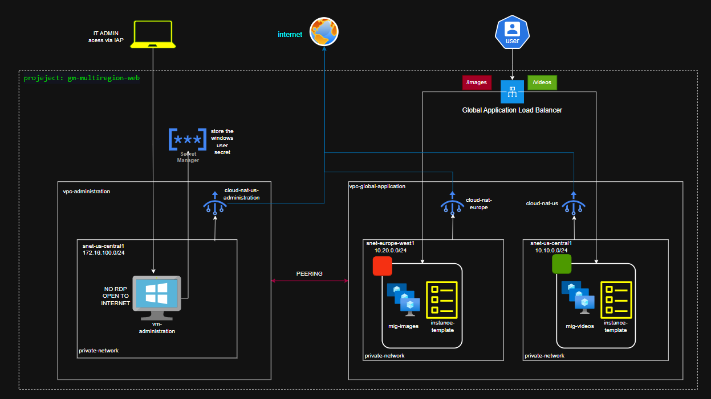
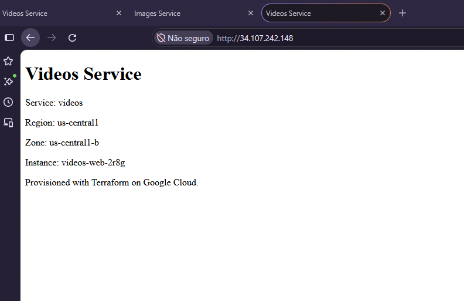
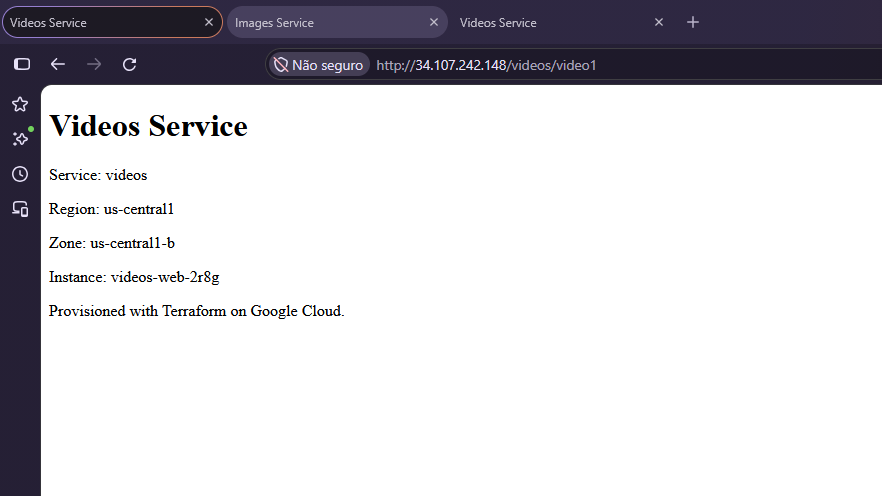
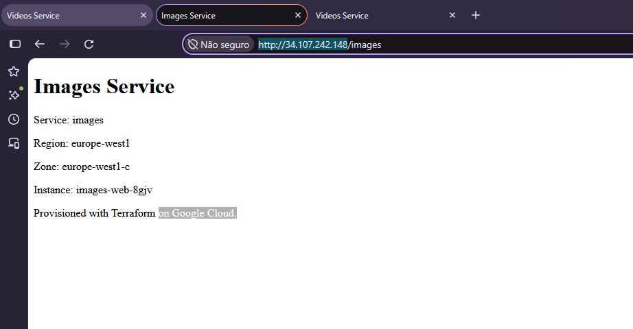
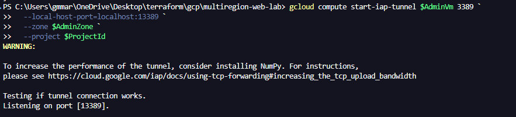
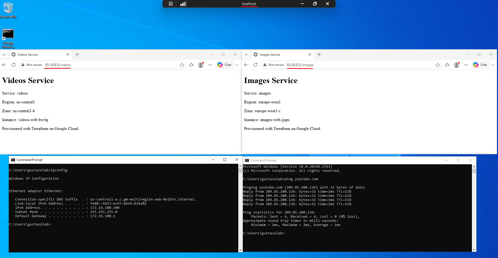

# GCP Multiregion Web Lab

This Terraform project provisions a small Google Cloud web platform in two regions. It demonstrates a global external HTTP load balancer with path-based routing, regional managed instance groups, private application VMs, Cloud NAT, VPC Network Peering, and administrative access to a private Windows VM through Identity-Aware Proxy (IAP).

> **Lab scope:** This is a learning and demonstration environment, not a production-ready website. The public frontend currently serves HTTP only, and each web service is deployed in one region.

## Architecture

#### Infrastructure topology



### Web application

- Terraform creates a Google Cloud project with a generated suffix on its project ID.
- The application VPC contains separate regional subnets for the `videos` and `images` services.
- Each service has a regional managed instance group (MIG), based on a regional instance template. The default target size is one VM per service; `instances_per_service` can increase the fixed group size.
- The Linux VMs have no external IP addresses. A regional Cloud Router and Cloud NAT provide outbound internet access for package installation and other egress needs.
- A global external managed HTTP load balancer uses a public IPv4 address and routes requests by URL path:

  | Request path | Backend |
  | --- | --- |
  | `/videos` and `/videos/*` | Videos MIG |
  | `/images` and `/images/*` | Images MIG |
  | `/` and unmatched paths | Videos MIG (default) |

- Load-balancer health checks and MIG auto-healing checks use `/health`. These checks are separate resources with different intervals and thresholds.
- The startup template installs NGINX, writes a service-specific page containing the service, region, zone, and instance name, and configures the health endpoint.
- Backend firewall ingress on TCP port 80 is limited to Google load-balancer and health-check ranges. A separate rule permits HTTP diagnostics from the administration VM's reserved private IP.


### Administration and private connectivity

- A separate administration VPC and subnet host a Windows administration VM with a reserved private IP and no external IP.
- Bidirectional VPC Network Peering connects the administration and application VPCs. Peering provides private network connectivity; firewall rules still control which traffic is allowed.
- The administration VPC has its own Cloud NAT for outbound access.
- An IAP firewall rule permits TCP port 3389 only from Google's IAP TCP forwarding range (`35.235.240.0/20`) and targets the `admin-windows` network tag.
- IAM grants the configured principal the IAP tunnel role on the administration VM, with an IAM condition restricting the destination port to 3389.
- A generated Windows password is stored in Secret Manager. The administration VM's service account receives access to that secret for its startup configuration.
- The Windows VM enables Secure Boot, vTPM, and integrity monitoring.

### Validation evidence

#### Load-balancer route: home page



This screenshot demonstrates a request to the load balancer's root path (`/`). Since there is no dedicated root-path backend, the URL map sends the request to the configured default backend, the videos service.

#### Load-balancer route: videos service



This screenshot demonstrates path-based routing for `/videos`: the response identifies the videos service and shows instance metadata returned by its web page.

#### Load-balancer route: images service



This screenshot demonstrates path-based routing for `/images`: the request reaches the images backend rather than the default videos backend.

#### IAP tunnel established



This screenshot shows the IAP TCP forwarding session used to make the administration VM's private RDP port available on a local port. The VM does not need a public IP address for this connection.

#### RDP and private backend connectivity



This screenshot documents the end-to-end administration workflow: connect to the Windows administration VM over RDP through IAP, then reach the web application backends using their internal IP addresses across the VPC Peering connection.

These screenshots document manual demonstrations; they are not an automated test suite or a guarantee of production availability.

## Repository contents

| File or directory | Purpose |
| --- | --- |
| `project.tf` | Creates the Google Cloud project and generated project ID suffix. |
| `apis.tf` | Enables the required Google Cloud APIs. |
| `providers.tf`, `versions.tf` | Configures the Google provider and Terraform/provider version constraints. |
| `variables.tf`, `locals.tf` | Declares input variables, validations, and shared service/bootstrap values. |
| `network.tf`, `network_admin.tf`, `peering.tf` | Defines the application and administration VPCs, subnets, and bidirectional peering. |
| `firewall.tf`, `firewall-admin.tf` | Defines application backend and IAP/RDP ingress rules. |
| `nat.tf`, `nat-admin.tf` | Configures regional Cloud Router and Cloud NAT resources. |
| `instance-templates.tf`, `managed-instance-groups.tf` | Defines Linux VM templates and regional MIGs, including auto-healing and replacement policy. |
| `health-checks.tf` | Defines load-balancer and MIG auto-healing health checks. |
| `load-balancer.tf` | Defines the global HTTP load balancer, URL map, backends, proxy, and forwarding rule. |
| `iam.tf`, `iam-admin.tf`, `admin-iap.tf` | Defines VM service accounts, logging permission, and conditional IAP tunnel access. |
| `admin-address.tf`, `vm-administration.tf` | Reserves the administration VM's private IP and creates the Windows VM. |
| `admin-secrets.tf` | Generates and stores the Windows account password in Secret Manager. |
| `outputs.tf` | Exposes project, network, load-balancer, MIG, and administration connection details. |
| `scripts/startup.sh.tftpl` | Installs/configures NGINX on Linux web instances. |
| `scripts/windows-startup.ps1.tftpl` | Configures the local Windows administration account during startup. |
| `global-alb-2-instances-group.drawio` | Editable draw.io load-balancer and instance-group diagram. |
| `images/` | Topology and manual test evidence. |

## Prerequisites

- Terraform **1.6 or later**.
- Google Cloud CLI (`gcloud`).
- A Google Cloud identity with permission to create a project, associate the supplied billing account, enable services, and create the listed networking, compute, IAM, IAP, and Secret Manager resources. Organization policies may require additional permissions or an organization ID.
- A billing account and available quota in the selected regions. This lab creates billable resources, including a Windows VM, NAT gateways, and a load balancer.

Authenticate the Google provider using Application Default Credentials:

```powershell
gcloud auth application-default login
```

The required values are declared in `variables.tf`. Supply them in a local `terraform.tfvars` file or through another Terraform variable mechanism:

- `billing_account_id`
- `region_videos`, `region_images`, and `region_admin`
- `subnet_videos_cidr`, `subnet_images_cidr`, and `subnet_admin_cidr`
- `private_ip_admin`
- `admin_zone` (must be in `region_admin`)
- `admin_machine_type`, `admin_boot_disk_size_gb`, and `admin_windows_image`
- `iap_admin_member` (for example, `user:admin@example.com`)
- `admin_windows_username`

`org_id` has no default in the current variable declaration, so set it to the organization ID when creating the project under an organization, or explicitly set `org_id = null` when creating it outside an organization. The other variables have defaults in `variables.tf`; override them as needed. Do not commit billing details, local variable files, or Terraform state.

## Deploy

Run these commands from this directory:

```powershell
terraform init
terraform fmt -check
terraform validate
terraform plan
terraform apply
```

Review the plan before applying. Terraform creates and manages the project as well as its resources. The project resource has a deletion policy of `DELETE`; destroying this configuration can delete the project and its resources. Confirm the target and backups before running:

```powershell
terraform destroy
```

The global load-balancer IP and test URLs are available after deployment:

```powershell
terraform output -raw load_balancer_ip
terraform output -json web_urls
```

Open the reported URLs in a browser or use a command-line HTTP client to check the default, `/videos`, and `/images` routes. The application frontend is currently HTTP on port 80.

## Connect to the Windows administration VM through IAP

The administration VM has no public IP. Use IAP TCP forwarding to expose its RDP port on a local port. In the first PowerShell window, run:

```powershell
$ProjectId = terraform output -raw project_id
$AdminVm = terraform output -raw administration_vm_name
$AdminZone = terraform output -raw administration_vm_zone

gcloud compute start-iap-tunnel $AdminVm 3389 `
  --local-host-port=localhost:13389 `
  --zone $AdminZone `
  --project $ProjectId
```

Keep the tunnel command running. In a second PowerShell window, connect with Remote Desktop:

```powershell
mstsc /v:localhost:13389
```

Use the local Windows username from `terraform output -raw administration_windows_username`. The generated password is stored in Secret Manager; retrieve it only as an authorized operator, and avoid putting it in shell history or sharing it:

```powershell
gcloud secrets versions access latest `
  --secret=administration-windows-password `
  --project=$ProjectId
```

The connecting Google identity must be the principal configured by `iap_admin_member` and must have the required IAP tunnel permission. The applicable firewall rule allows RDP only from IAP's proxy range. Once connected, the administration VM can reach the web backends over their internal addresses through VPC Peering, subject to the application firewall rule.

## Security and operational notes

- The application and administration VMs do not have external IP addresses. Use IAP for administrative RDP access.
- Backend ingress is restricted to load-balancer/health-check source ranges, with a separate HTTP diagnostic rule for the administration VM's private IP.
- VM service accounts are separate and are not assigned broad project roles here; the Windows service account is granted Secret Manager access to the generated password and log-writer permission.
- The public load balancer currently serves **HTTP only**. Add HTTPS and managed certificates before using this pattern for real user data or production traffic.
- Terraform state can contain sensitive values, including the generated Windows password and Secret Manager version data. The local `terraform.tfstate` and backup files in this directory must be treated as secrets. Keep state out of source control and use a protected remote GCS backend with tightly restricted IAM and appropriate state access controls.
- Keep `terraform.tfvars` and other local configuration containing account, network, or identity details out of source control. Rotate credentials if state or configuration containing sensitive values has been exposed.
- The Windows account configured by the startup script is a local administrator. Limit IAP access to trusted users and review IAM bindings regularly.
- A single instance per service is the default, and each service is in one region. Consider regional redundancy, autoscaling, patch management, monitoring/alerting, and recovery procedures before production use.

## Project difficulty

**Intermediate.** The project combines Terraform modules/files, project and API provisioning, VPC design, regional resources, peering, NAT, IAM, Secret Manager, Windows startup configuration, and a global load balancer. Understanding how those services interact and troubleshooting routing, firewall, identity, and bootstrapping behavior requires practical GCP experience.

## Potential improvements

1. Add HTTPS with Google-managed certificates and redirect HTTP to HTTPS.
2. Deploy each service across multiple regions and configure backend failover; enable autoscaling and capacity controls.
3. Move Terraform state to a secured remote GCS backend, and add a documented state recovery and access-control process.
4. Add automated validation and integration tests for routing, health checks, firewall reachability, and IAP access.
5. Add Cloud Monitoring dashboards and alerts, plus centralized and appropriately retained logs.
6. Use hardened, version-pinned VM images and define an OS patching strategy; review startup-script error reporting and retry behavior.
7. Review IAM and service-account scopes, apply organization policies where appropriate, and add least-privilege controls for project creation and secret access.
8. Add cost controls such as budgets/alerts, and consider teardown automation for temporary lab deployments.
